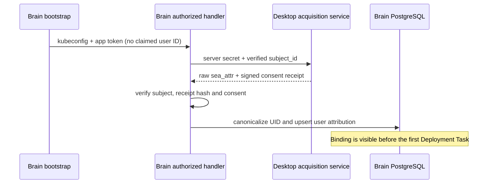

# Marketing acquisition handoff (phase one)

Tracks labring/sealox#584 and its phase-one MP collector in labring/sealox#581.

## Ownership and behavior

Desktop authentication owns the durable website visitor → installation → verified account mapping. Brain never reconstructs this relationship from IP, browser claims, a workspace member, or an unsigned user ID. Brain reads the account snapshot only after its existing kubeconfig + app-token authorization has proved a global user UID (ADR 0059).

The server-only `MARKETING_ATTRIBUTION_API_BASE_URL` identifies one deployment's trusted authentication authority. `ACQUISITION_INGEST_SECRET` authenticates service-to-service reads and lifecycle delivery; it is never exposed to browsers. A partial configuration is an observable configuration failure. No configured service means this optional integration is disabled.

The subject response must name the requested UID, contain version 1, the realm, an analytics-granted consent state, the original `sea_attr`, a fresh consent token and the linkage time. Existing v2/v3 attribution parsing, signed raw hash, explicit consent, fail-closed click-ID removal and identity canonicalization stay in force. Brain stores no access token or acquisition service secret. Bootstrap responses disclose only a status, never the snapshot, UID or token.

For Deployment Task creation, a server-fetched account snapshot takes precedence when available. The legacy inbound snapshot remains supported when the account has no linked acquisition record. An optional integration failure cannot fail deployment creation. Existing SQL triggers remain the only owners of build_started and deploy_success facts.

## Durable lifecycle delivery

The existing marketing lifecycle table is the outbox. Delivery state is added to each row. An optional publisher starts after database migrations, drains a bounded batch, locks pending rows with SKIP LOCKED and sends the existing event ID to the central collector. Every delivery checks that the account still has an analytics-allowed acquisition record. The collector must durably deduplicate by event ID: a network failure after acceptance can replay the same event. No independent client event is treated as a second business fact.

Successful deliveries are recorded; failed deliveries retain the event, attempt count, next-attempt time and a bounded error category. Multiple Brain replicas share the same SQL ownership. Historical rows are not automatically replayed on migration. Ten attempts exhaust automatic retries; the row remains inspectable and can be explicitly reset by an operator. The worker uses backoff and never alters Deployment Task success. Unattributed or consent-withdrawn events do not produce Google telemetry.

Supported forwarding names are build_started, deploy_success, new_subscription → subscribe_success and topup_success. Billing success still comes only from the account-service producer; this change does not invent revenue facts from the Brain billing proxy or browser settlement UI. running_24h remains stored but is outside the current collector's event contract.

## Acceptance

- Existing personal-resource authorization rejects missing credentials and a forged request-body UID cannot select another user's snapshot.
- With a linked account, authenticated Brain bootstrap persists a canonical user subject before any Deployment Task. Missing, mismatched, invalidly signed, disallowed and unavailable acquisition results never create a false association.
- A subsequent Deployment Task receives the same normalized source and UID; legacy attribution and deployment availability remain compatible.
- Real migrated PostgreSQL semantics preserve first touch and canonical account merges.
- A receiver sees the same stable lifecycle event ID after failed delivery/retry; successful delivery is not sent again. Unsupported events, revoked consent and missing subjects do not go to GA4. The collector's acknowledgement is not proof of a GA4 report or ad match.
- Run focused Bun tests plus repository `bun typecheck` and `bun check`. Production GA4 verification requires the separately configured collector, GA credentials and a real user journey; these are deployment acceptance, not fabricated test evidence.
